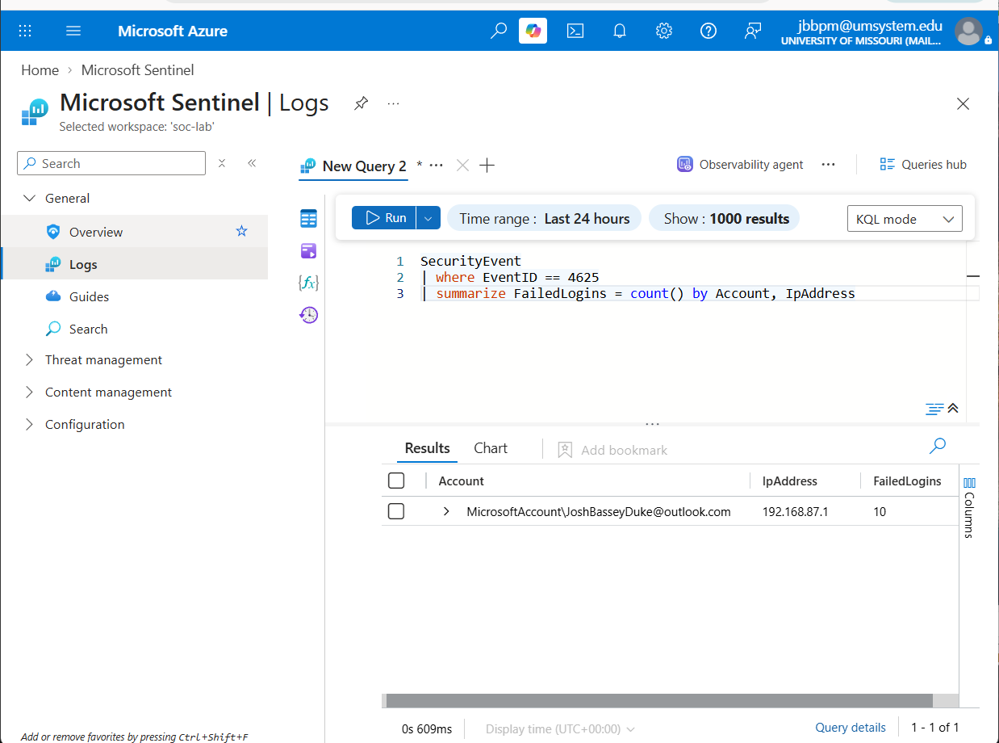
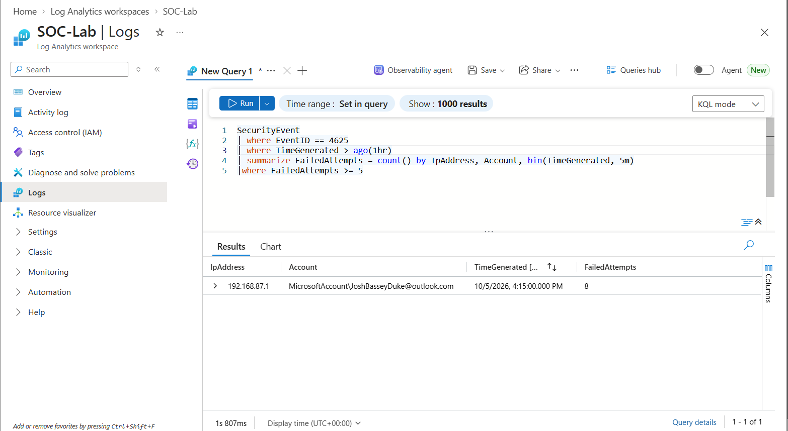
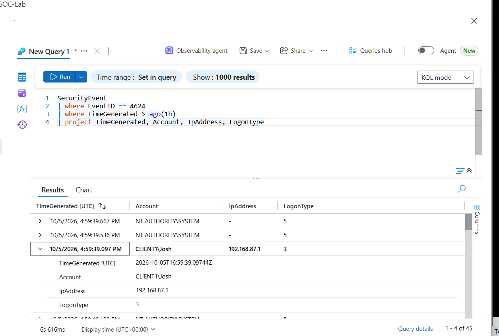
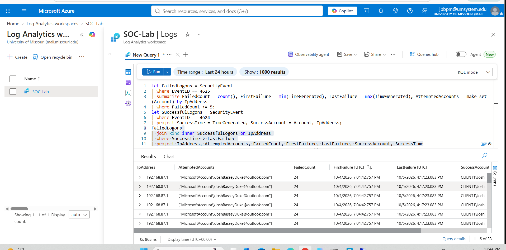
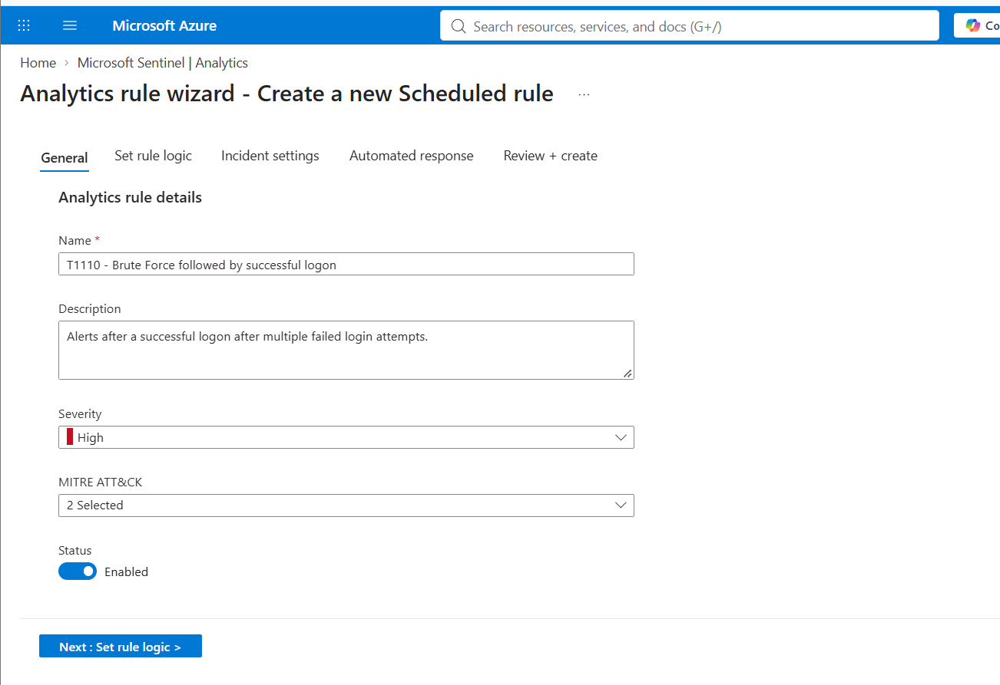
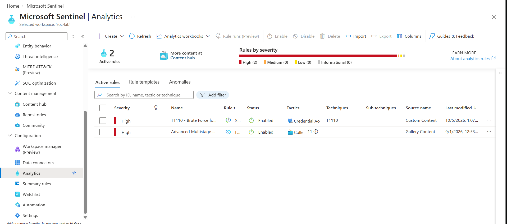
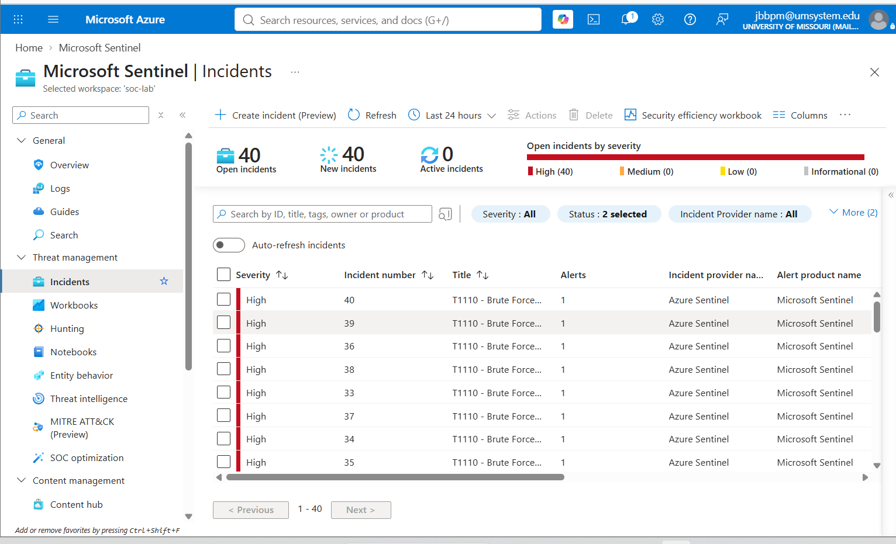
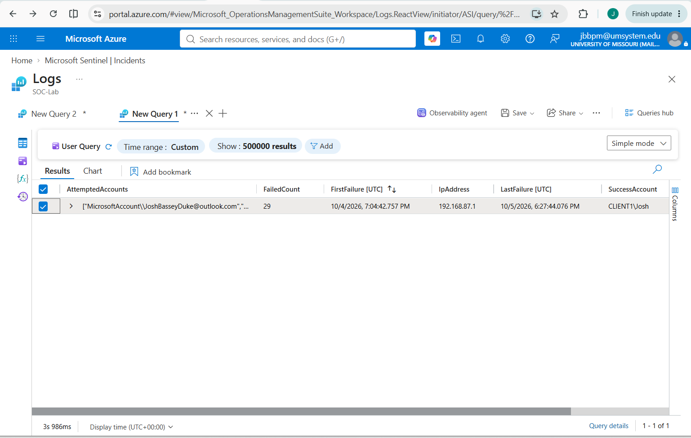

# Home SOC Lab: Brute-Force Detection with Microsoft Sentinel

A hands-on detection engineering project: ingest Windows Security logs into Microsoft Sentinel, generate a real brute-force attack against a monitored host, build a KQL detection for the highest-risk version of that attack (repeated failures followed by a successful logon), and deploy it as a scheduled analytics rule that creates incidents.

**MITRE ATT&CK:** Credential Access, T1110 (Brute Force)
**Tooling:** Microsoft Sentinel, Azure Log Analytics, Kusto Query Language (KQL), Windows Security Event Log
**Test period:** October 4-5, 2026

---

## Project Summary

| | |
|---|---|
| **Objective** | Detect a successful logon that follows a burst of failed authentication attempts from the same source |
| **Monitored host** | `CLIENT1.joshdomain.com` (Windows, joined to the lab AD domain) |
| **Log source** | Windows Security Events forwarded to a Log Analytics workspace (`SecurityEvent` table) |
| **Events used** | 4625 (failed logon), 4624 (successful logon) |
| **Attack method** | Repeated failed sign-ins via Remote Desktop Connection, then a successful sign-in |
| **Detection output** | Scheduled analytics rule: `T1110 - Brute Force followed by successful logon` (High severity) |

## Architecture

```
Remote Desktop Connection (192.168.87.1)
        |  failed logons, then a successful logon
        v
CLIENT1 (Windows Security log: 4625 / 4624)
        |  Azure Monitor Agent + Data Collection Rule
        v
Log Analytics workspace "SOC-Lab"  --->  Microsoft Sentinel
                                              |  scheduled KQL analytics rule
                                              v
                                          Incidents (High)
```

---

## 1. Telemetry Validation

Before writing any detection, I confirmed Security events were reaching the workspace. Initial ingestion failed, so I troubleshot it in layers: checked the `Heartbeat` table to confirm the agent was alive, then verified the Data Collection Rule was collecting the Security log and sending it to the same workspace I was querying. Once corrected, `SecurityEvent` populated normally.

## 2. Attack Simulation

I generated failed logons by attempting Remote Desktop connections to `CLIENT1` with incorrect credentials from my host machine (`192.168.87.1`), then signed in successfully to complete the "brute force that eventually worked" pattern.

One detail worth noting from the raw events: the failures logged as **LogonType 3 (Network)** rather than LogonType 10 (RemoteInteractive). With Network Level Authentication enabled, RDP credentials are validated over the network before a full session exists, so failed RDP attempts commonly appear as network logons. A detection hardcoded to LogonType 10 would have missed this attack entirely.

## 3. Building the Detection (KQL)

I built the query incrementally, validating each stage against real data.

**Stage 1: Isolate failed logons and count them**

```kql
SecurityEvent
| where EventID == 4625
| summarize FailedLogins = count() by Account, IpAddress
```

Returned 10 and later 16 failures from `192.168.87.1` as I ran additional tests.




**Stage 2: Add a time window so volume means something**

```kql
SecurityEvent
| where EventID == 4625
| where TimeGenerated > ago(1hr)
| summarize FailedAttempts = count() by IpAddress, Account, bin(TimeGenerated, 5m)
| where FailedAttempts >= 5
```

A raw count over all history is noise; 8 failures inside a single 5-minute bin is a signal.



**Stage 3: Check the success side**

```kql
SecurityEvent
| where EventID == 4624
| where TimeGenerated > ago(1h)
| project TimeGenerated, Account, IpAddress, LogonType
```



This step exposed a flaw in my first design. My original join matched on both `Account` and `IpAddress`, and it returned nothing. The failures were recorded under `MicrosoftAccount\JoshBasseyDuke@outlook.com` (a cached credential in the RDP prompt) while the successful logon was `CLIENT1\Josh`. Same source IP, different account string.

Requiring the same username on both sides is also an unrealistic assumption: real attackers try several usernames from one source before one works. I changed the join to key on **source IP**, and used `make_set()` to preserve which accounts were attempted.

**Stage 4: Final detection, failures followed by success**

```kql
let FailedLogons = SecurityEvent
| where EventID == 4625
| where TimeGenerated > ago(1h)
| summarize FailedCount = count(), FirstFailure = min(TimeGenerated), LastFailure = max(TimeGenerated), AttemptedAccounts = make_set(Account) by IpAddress
| where FailedCount >= 5;
let SuccessfulLogons = SecurityEvent
| where EventID == 4624
| where TimeGenerated > ago(1h)
| project SuccessTime = TimeGenerated, SuccessAccount = Account, IpAddress;
FailedLogons
| join kind=inner SuccessfulLogons on IpAddress
| where SuccessTime > LastFailure
| project IpAddress, AttemptedAccounts, FailedCount, FirstFailure, LastFailure, SuccessAccount, SuccessTime
```

| KQL concept | Role in this query |
|---|---|
| `let` | Names each sub-query so the final join stays readable |
| `summarize` + `count()` / `min()` / `max()` | Collapses raw events into one row per source IP with a failure count and time range |
| `make_set()` | Collects every distinct account tried from that IP (separates targeted brute force from password spray) |
| `join kind=inner` | Keeps only IPs that have both a failure burst and a later success |
| `where SuccessTime > LastFailure` | Enforces ordering: the success must come after the failures |

The query returned a match: 24 failures from `192.168.87.1` followed by a successful logon as `CLIENT1\Josh`.



---

## 4. Deploying the Analytics Rule

I converted the query into a Sentinel scheduled analytics rule.

| Setting | Value |
|---|---|
| Name | `T1110 - Brute Force followed by successful logon` |
| Severity | High |
| Tactic / Technique | Credential Access / T1110 |
| Rule type | Scheduled query |
| Status | Enabled |




## 5. Results

The rule fired and generated High-severity incidents in the Sentinel incident queue.



Investigating from the incident, the underlying query showed 29 failed attempts from `192.168.87.1` between Oct 4, 7:04 PM and Oct 5, 6:27 PM UTC, followed by a successful logon as `CLIENT1\Josh`.



---

## 6. Findings and Tuning

**The detection works, but it is too noisy as deployed.** One attack burst produced 40 open incidents, all High severity. Two causes are likely:

1. **One row per successful logon.** The join returns a row for every 4624 event that follows the failures. A single IP with many successful network logons produces many result rows (the query returned 33 rows in one run), and each row can become its own alert.
2. **Overlapping lookback windows.** The query looks back an hour but runs on a short schedule, so the same failure burst is re-detected on successive runs until it ages out of the window.

---

## Skills Demonstrated

- Standing up and validating a SIEM data pipeline (workspace, agent, Data Collection Rule), including systematic troubleshooting of missing logs
- Reading raw Windows Security events and interpreting logon types (including the NLA/RDP behavior)
- Writing and iterating KQL: filtering, aggregation, time binning, `let` variables, joins, `make_set()`
- Catching and correcting a flawed detection assumption using real data
- Mapping a detection to MITRE ATT&CK and deploying it as a scheduled analytics rule
- Critically evaluating detection quality: alert volume, duplicate incidents, false-positive scenarios


## Notes

- This is a lab: the "attacker" is my own host machine, and all accounts and IPs are private lab addresses.
- Sentinel bills on data ingestion. Set a budget alert and delete the workspace or disable the rule when you are done experimenting.
